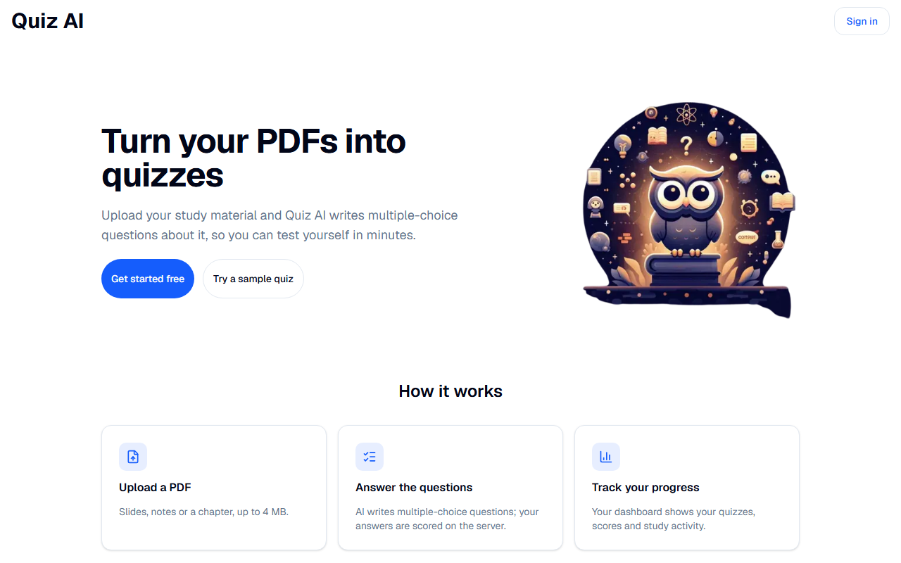
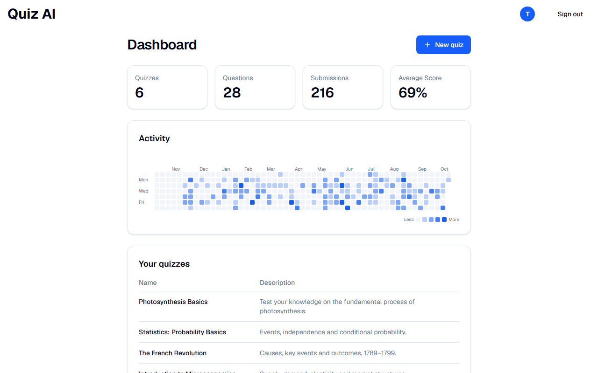
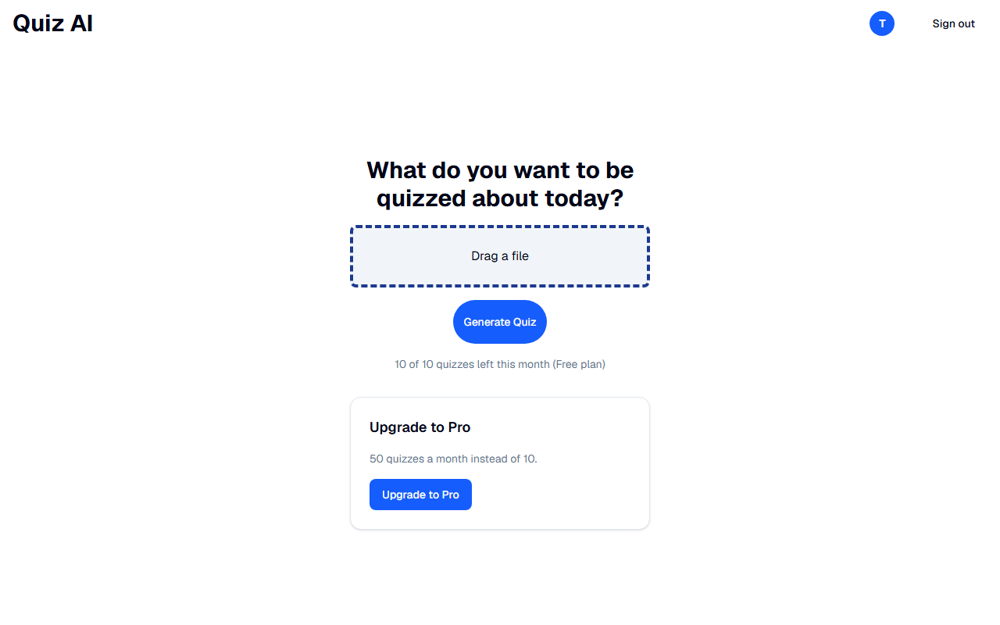
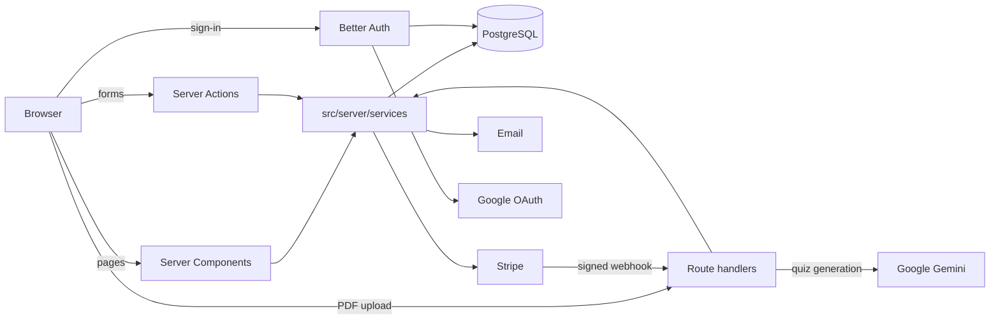

# Quiz AI

[](https://github.com/Ziad-Alghawi/nextjs-quiz-ai/actions/workflows/ci.yml)

Upload a PDF and Quiz AI turns it into a multiple-choice quiz, scores your answers and tracks your
progress over time.

**Live:** https://quiz-ai-gamma.vercel.app (payments run in Stripe test mode: card `4242 4242 4242 4242`)

`main` is the live site; new work is developed on branches and released at planned checkpoints.

## Screenshots

| Landing page                                  | Dashboard                                    |
| --------------------------------------------- | -------------------------------------------- |
|  |  |

| Create a quiz                                   | Taking a quiz                               | Result                                 |
| ----------------------------------------------- | ------------------------------------------- | -------------------------------------- |
|  |  |  |

## Features

- **Accounts:** sign up with email and password or continue with Google. Forgotten passwords are
  reset with a 6-digit code sent by email.
- **Settings:** change name, email (confirmed by a code sent to the new address) and password,
  connect Google, delete the account (this also cancels the subscription).
- **Quiz generation:** upload a PDF (up to 4 MB); the server extracts the text and Gemini returns a
  structured quiz that is validated before it is saved. Very long documents use their first part.
- **Taking a quiz:** one question at a time with progress, answer feedback and a score at the end.
  The server scores the answers and saves the result.
- **Dashboard:** number of quizzes, questions and attempts, average score, and an activity heatmap
  (keyboard accessible, built without a chart library).
- **Plans:** Free (10 quizzes a month) and Pro (50 a month), plus a limit of 3 generations per
  10 minutes. Pro is sold through Stripe Checkout and managed in the Stripe billing portal.
- **Sample quiz** to try the app without an account, light and dark mode (follows the system), and
  responsive layouts down to phone width.

## Tech stack

| Area           | Choice                                                                            |
| -------------- | --------------------------------------------------------------------------------- |
| Framework      | Next.js 16 (App Router, Server Components, Server Actions), React 19              |
| Language       | TypeScript (strict), Zod for validation                                           |
| Database       | PostgreSQL 17 with Drizzle ORM and committed migrations                           |
| Auth           | Better Auth: email/password, Google OAuth, database sessions                      |
| AI             | Google Gemini 2.5 Flash through LangChain (structured output), unpdf for PDF text |
| Payments       | Stripe Checkout, billing portal and webhooks                                      |
| Email          | Nodemailer over SMTP                                                              |
| UI             | Tailwind CSS 4, Radix UI primitives, lucide icons                                 |
| Testing and CI | Vitest, GitHub Actions                                                            |
| Hosting        | Vercel (app), Supabase (Postgres)                                                 |

## Architecture



- **Reads:** Server Components call the services in `src/server/services`.
- **Writes:** Server Actions in `src/app/actions` validate the input with Zod, check the session and
  call a service.
- **Route handlers** only where plain HTTP is needed: PDF upload and generation, the Stripe webhook,
  auth and `/api/health`.
- **Business logic and every database query** live in the services; components and handlers stay thin.

## Run it locally

Requirements: Node.js 20.9 or newer and Docker (the database runs in a container).

```bash
npm install
cp .env.example .env     # fill in the values, see the table below
npm run db:up            # Postgres 17 in Docker
npm run db:migrate       # apply the migrations in drizzle/
npm run dev              # http://localhost:3000
```

Without SMTP settings, emails (reset and email-change codes) are printed to the terminal. For the
Stripe webhook, run `stripe listen --forward-to localhost:3000/api/stripe/webhook` and put the
secret it prints into `STRIPE_WEBHOOK_SECRET`.

## Environment variables

All of them are validated with Zod when the server starts (`src/lib/env.ts`).

| Name                    | Purpose                                           |
| ----------------------- | ------------------------------------------------- |
| `DATABASE_URL`          | PostgreSQL connection                             |
| `AUTH_SECRET`           | Signs session cookies                             |
| `GOOGLE_CLIENT_ID`      | Google sign-in                                    |
| `GOOGLE_CLIENT_SECRET`  | Google sign-in                                    |
| `GEMINI_API_KEY`        | Quiz generation                                   |
| `STRIPE_SECRET_KEY`     | Checkout and billing portal                       |
| `STRIPE_WEBHOOK_SECRET` | Verifies Stripe webhook signatures                |
| `STRIPE_PRICE_ID`       | The Pro subscription price                        |
| `APP_URL`               | Public base URL (auth and Stripe return links)    |
| `EMAIL_TRANSPORT`       | `console` (default) or `smtp`                     |
| `SMTP_HOST`             | SMTP server (only with `EMAIL_TRANSPORT=smtp`)    |
| `SMTP_PORT`             | SMTP port (only with `EMAIL_TRANSPORT=smtp`)      |
| `SMTP_USER`             | SMTP account (only with `EMAIL_TRANSPORT=smtp`)   |
| `SMTP_PASSWORD`         | SMTP password (only with `EMAIL_TRANSPORT=smtp`)  |
| `EMAIL_FROM`            | Sender address (only with `EMAIL_TRANSPORT=smtp`) |

## Security decisions

- **Ownership on every read and write:** someone else's quiz is a 404, the same as a missing one, so
  ids can't be probed. Server Actions check the session and validate their arguments with Zod.
- **The server scores attempts:** the browser sends only the chosen answer ids.
- **Payments:** the price comes from server configuration, never from the browser. The webhook
  verifies Stripe's signature, and the subscription status alone decides the plan (failed renewals
  lose Pro).
- **Authentication:** scrypt password hashes, database sessions, rate limits on sign-in, sign-up and
  password reset (stored in Postgres so they work across serverless instances), the same answer for
  new and existing emails at sign-up, and no session token in API responses.
- **Linking Google** to an account requires the same email address.
- **Uploads:** PDF signature and a 4 MB size limit, checked in the browser and on the server.
- **Cost control:** monthly quotas and a burst limit enforced on the server, a per-user database lock
  so parallel requests can't both take the last slot, and a cap on the document text sent to the model.
- **Failures are visible:** a database outage shows an error page instead of signing users out, and
  a result that couldn't be saved says so.

## Tests and CI

- **Unit tests** (Vitest): validation schemas, scoring, environment parsing, error mapping, the
  session helper, the health route and the Stripe webhook (with signed test payloads).
- **Database tests** against a real Postgres: quotas under parallel requests, billing and auth rules.
- **CI** (GitHub Actions, on every push and pull request): lint, format check, typecheck, unused-code
  check (knip), unit tests, migrations plus database tests against Postgres 17, and a production build.

```bash
npm run lint
npm run typecheck
npm run check:unused
npm test
npm run test:db    # needs the Docker database
npm run build
```
